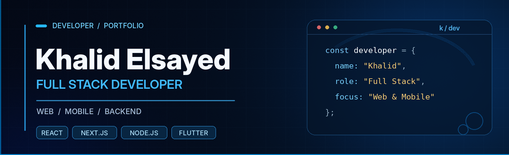

<!-- GitHub Profile README | Khalid Elsayed | github.com/khalidki7777 -->

  ### Building modern web experiences and practical digital products.

  
  
  

---

## 👨‍💻 About Me

I'm **Khalid Elsayed**, a **Full Stack Developer** who enjoys creating responsive interfaces, building backend features, and bringing web and mobile ideas to life.

- 💻 I work across **frontend, backend, and mobile development**.
- 🛠️ I enjoy turning ideas into functional, maintainable applications.
- 🗃️ I work with **relational and NoSQL databases**.
- 🌐 Explore more of my work on my [portfolio](https://khalid-portfolio3d.vercel.app).

---

## 🧰 Tech Stack

### Frontend

  
  
  
  
  
  

### Backend

  
  
  
  

### Mobile

  

### Databases & Services

  
  
  
  

### Tools

  

---

## 🚀 Featured Projects

| Project | Highlights | Link |
| :--- | :--- | :--- |
| **🛍️ TinyTales** | E-commerce application built with **Next.js** and **TypeScript**, featuring authentication, responsive pages, and a user dashboard. | [View Code ↗](https://github.com/khalidki7777/tinytales) |
| **🎬 UI Interaction Clips** | A collection of interface demo videos covering menus, accordions, popups, and loading animations. | [View Repository ↗](https://github.com/khalidki7777/videos) |
| **🌐 Personal Portfolio** | My portfolio website and a place to explore more of my work. | [Visit Website ↗](https://khalid-portfolio3d.vercel.app) |

  

---

## 📊 GitHub Stats

  
  

  

---

  ### 🤝 Let's Connect

  Have a project in mind or want to talk about development?

  **[Portfolio](https://khalid-portfolio3d.vercel.app) · [LinkedIn](https://www.linkedin.com/in/khalid-ki-7382372ba/) · [Email](mailto:kikhalid192@gmail.com)**

  

